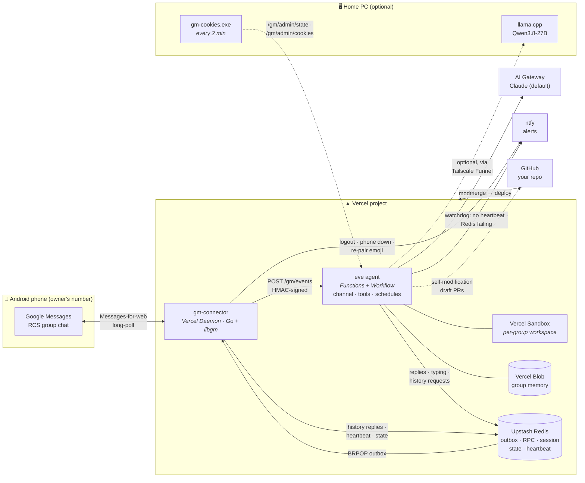

# rcs-group-bot

**An AI member for your Google Messages group chat.** Start a message with "bot" and it replies right in the thread. It looks things up, settles arguments with sources, reads photos, remembers things about your group, digs up old messages, and sets reminders. Ask it for a new feature and it writes the code itself, as a pull request you approve.

```text
Sam:     bot who's right, is a hot dog a sandwich?
🤖 bot:  Sam says yes, Jordan says no. By the USDA's labeling definition (meat
         between bread), Sam's technically right. But Merriam-Webster and the
         National Hot Dog and Sausage Council both say it's its own thing.
         Verdict: Sam wins on paper, Jordan wins on vibes.
Jordan:  [photo] bot what plant is this, is it safe for my cat
🤖 bot:  That's a pothos. Not safe: it's toxic to cats (mouth irritation,
         drooling, vomiting). Keep it on a high shelf.
```

There's no new app or phone number to set up. The bot runs on [Vercel](https://vercel.com) and posts **from your own Android phone's number**, with every message starting with 🤖 so nobody confuses it with you. Everyone in the group just keeps using their normal messaging app, iPhones included.

> [!WARNING]
> This uses an **unofficial, reverse-engineered** Google Messages web protocol (the same one as [mautrix-gmessages](https://github.com/mautrix/gmessages)). Google could change or block it at any time, and using it may go against Google's terms. Only add the bot to chats where **everyone knows and is OK with** an AI reading the messages sent to it. See [Privacy](#privacy-what-the-bot-sees-and-stores).

## Contents

- [Get started](#get-started)
- [What it can do](#what-it-can-do)
- [Using it in the chat](#using-it-in-the-chat)
- [What it costs](#what-it-costs)
- [Privacy: what the bot sees and stores](#privacy-what-the-bot-sees-and-stores)
- [Things to know](#things-to-know)
- [Make it yours](#make-it-yours)
- [How it works (technical)](#how-it-works-technical)

## Get started

**The easiest way is to let an AI coding agent set it up for you.** The setup guide, [`SETUP.md`](SETUP.md), is written so an agent like [Claude Code](https://claude.com/claude-code) can do everything: create the cloud resources, generate and store the secrets, and deploy. It stops only for the parts that need you (signing in to Google, tapping an emoji on your phone, choosing the chat).

1. Click **Use this template → Create a new repository**, and make it **private**, because it'll hold your friends' names. From a terminal: `gh repo create my-group-bot --private --template pwillia7/rcs-group-bot --clone`
2. Open your new repo in Claude Code and type **`/setup`**. With another agent, tell it *"Set up this bot by following SETUP.md."*

It takes about 30–45 minutes. If you'd rather do it yourself, `SETUP.md` works as a normal step-by-step guide too.

**What you need:**

- An **Android phone** with Google Messages as its texting app and **RCS chats** turned on. It hosts the bot, so it should stay on and connected.
- A **[Vercel](https://vercel.com) account on the Pro plan.** The part that talks to your phone runs around the clock, which needs Pro.
- A **GitHub** account.
- A computer with Chrome, for the one-time sign-in.

## What it can do

- **Answer questions and look things up**, with sources. It searches the web, reads pages, and uses free data sources for sports scores, weather and more. For sites that only work in a real browser, it has one.
- **Settle arguments fairly.** It states each side, checks the facts, and gives a verdict with sources. The phone's owner gets no special treatment.
- **Look at photos**, including one sent together with the question.
- **Remember things** about the group ("bot remember that Sam is vegetarian"), in a shared notes document.
- **Search the chat's history** on the phone, even from before the bot joined ("bot when did we last talk about the cabin trip?").
- **Set reminders** ("bot remind us Friday at 7 to book the table"), including repeating ones.
- **Send GIFs** ("bot send a gif of Michael Scott saying no"), as real animated attachments. No API key: it searches Tenor (then Giphy), or sends any GIF link it finds on the web.
- **Run polls** ("bot start a poll: Friday or Saturday?"). People vote by just texting the letter ("B"), can add options ("add Sunday"), and see results with "poll status".
- **Post a daily "stupid quote"** dug up from the chat's past (optional, 9 AM).
- **Add features to itself.** "bot, add a tool that tracks who owes who money" makes the bot write the code and open a draft pull request on your GitHub repo. Nothing changes until the owner reviews and merges it.

## Using it in the chat

The bot answers a message when it **starts with "bot"**, or "hey bot", "ok bot", "yo bot", or when it contains **"@bot"** anywhere. Talking *about* the bot ("the bot was wrong yesterday") doesn't trigger it. It reads the recent messages since it last spoke, so "bot what do you think?" works mid-conversation.

| Command | What it does |
|---|---|
| `/status` | Shows which AI model the next reply will use |
| `/model auto` · `/model claude` · `/model qwen` | Switch models (`qwen` is only for the optional local model) |
| `/new` | Start a fresh conversation. Long-term notes are kept. |
| `/help` | Show the commands |

## What it costs

- **Vercel Pro:** $20/month per seat, plus usage. A group chat bot uses very little.
- **AI replies:** pay as you go through [Vercel AI Gateway](https://vercel.com/ai-gateway). With the default model (Claude Sonnet 5.5) a typical reply costs about **1–2 cents**, and a web search adds about $0.007.
- **Vercel Blob:** the free tier is plenty.
- **Upstash Redis:** the connector's idle loops use about 375K commands a month, and chat adds a little more. That fits under the free tier's 500K, but when the free tier hits its cap *every* command fails and the bot goes offline until the month resets. Pay as You Go ($0.20 per 100K commands, under $1/month here) removes the cap.
- **Optional:** run replies on your own gaming PC (24 GB of GPU memory) with a local Qwen model, and AI replies become free whenever the PC is on.

## Privacy: what the bot sees and stores

- **One chat only.** The connector reads only the conversation(s) you list in `ALLOWED_CONVERSATIONS`. Everything else on the phone is dropped on the spot, never logged and never sent anywhere.
- **What goes to the AI:** messages addressed to the bot, up to 40 messages posted since it last replied (for context), and up to 4 recent photos. They're sent to your model provider (Anthropic via Vercel AI Gateway, or your own PC).
- **What's stored:** recent un-addressed messages and photos are kept in your Redis for up to 3 days as context, then deleted. The bot's conversation history and its notes document live in your Vercel project. The Google session is stored encrypted.
- **It's all yours.** Every piece runs in your own Vercel, Upstash and GitHub accounts. Nothing goes to the authors of this project.
- The bot's messages appear as sent by the phone's owner (with the 🤖 prefix), because they are.

## Things to know

- **The phone has to stay on and online.** If it dies or loses signal, the bot goes quiet until it's back.
- **Google signs the bot out a few times a day.** You get a phone alert (via [ntfy](https://ntfy.sh)), and reconnecting takes a few minutes in a browser. If you have a Windows PC that's always on, the included cookie helper reconnects it automatically within about 2 minutes.
- **One group per bot** is the intended setup. Each group gets its own copy, with its own personality file.
- **It's an AI.** It can be wrong. It cites sources when it checks facts, so you can verify them.

## Make it yours

| What | Where |
|---|---|
| **Who's in the group**, nicknames, who owns the phone | `agent/instructions/group.md`. Every group edits this. |
| The bot's **personality and rules** (tone, how it argues, when it searches) | `agent/instructions.md` |
| **Settings**: trigger word, timezone, model, daily quote, alerts | Vercel environment variables, all listed in [`.env.example`](.env.example) |
| **New abilities** | Add a tool in `agent/tools/`, or just ask the bot to build one |
| Run on your **own GPU** | `desktop/qwen-bot/` (Windows + llama.cpp), see SETUP.md step 9 |

The agent is built with [eve](https://eve.dev), Vercel's framework for durable AI agents. Its docs cover tools, skills, schedules and memory.

## How it works (technical)



### How a message flows

1. Someone posts in the group. The **connector** holds a Messages-for-web session with the phone, using libgm, the reverse-engineered protocol behind [mautrix-gmessages](https://github.com/mautrix/gmessages). It drops anything outside `ALLOWED_CONVERSATIONS`, ignores its own 🤖 echoes, and POSTs the message to the agent's `/gm/events` webhook with an HMAC signature.
2. The **eve channel** (`agent/channels/gmessages.ts`) decides whether the message is for the bot:
   - **Not addressed:** the line goes into a short Redis backlog. It's used as context the next time someone mentions the bot.
   - **Addressed** (starts with "bot", or a `/command`): commands are handled directly. Otherwise the backlog plus the message start a turn in the group's durable eve session.
3. The **model router** (`agent/lib/models.ts`) uses Claude via Vercel AI Gateway by default. If you run the optional local Qwen, it checks Qwen's `/health` through Tailscale Funnel and prefers Qwen when it's up. If Qwen fails before answering, or sends no first token within 150 s (for example the GPU is busy with another job), middleware cancels it and reruns the call on Claude. A missed deadline also skips Qwen for 10 minutes (`gm:qwen-slow`, shown in `/status`). Compaction summaries always run on Claude, so a slow local model can't stall a long conversation. `/model` overrides the choice.
4. The model can use the **sandbox** (shell and files), **group memory** (a notes document in Blob), and **tools**. `read_history` asks the connector for older messages over a Redis request/reply, since the daemon accepts no inbound traffic.
5. Reply text is pushed to the **Redis outbox**. The connector pops it, adds the `🤖 ` prefix, and sends it from the phone.

### Keeping it alive

- **One connector at a time.** A Redis lease keeps rollouts from running two Google sessions at once. The libgm session is stored in Redis, encrypted with AES-GCM, because daemon disks are ephemeral.
- **Degraded mode.** If Google rejects the session, the connector stays up and alerts ntfy. The desktop **gm-cookies** helper notices within 2 minutes and pushes cookies from a dedicated, signed-in Chrome profile. The connector then refreshes the existing pairing with no emoji tap. If the pairing itself is gone, it re-pairs and sends the emoji to ntfy. The connector watches its own logs for Google's first HTTP 401, so it flips to degraded right away instead of waiting for libgm to give up.
- **No dropped messages.** If a message arrives but can't be forwarded (the session just expired, or the webhook failed), it goes on a retry queue in Redis and is re-sent once the connection is healthy (up to 10 tries, for up to 6 hours).
- **Redeploy note.** The first message after a new deployment tells the bot it was redeployed, so it checks its tool list instead of assuming a feature it proposed is still pending.
- **Redis budget.** Upstash bills per command, and the free tier stops *all* commands at 500K a month. The connector's idle loops are tuned for that (constants above `cmdServe` in `connector/main.go`): the standby blocks on a release signal instead of polling. A clean shutdown hands over to the standby immediately; a hard crash takes up to about 3.5 min.
- **Redis outages.** If Redis errors (an outage, or a used-up quota), the connector retries with backoff instead of crash-looping, and an unreadable session isn't mistaken for a lost pairing.
- **Phone off.** The connector nudges an unresponsive phone every 2 minutes, so it reconnects shortly after the phone is back.
- **Watchdog.** An eve schedule checks the connector's heartbeat every 10 minutes, so you hear about a dead daemon even though it can't alert for itself. It also alerts when Redis itself is failing.

### Self-modification

Anyone in the group can ask the bot for a new tool, skill or behavior change. A sub-agent checks out this repo in a sandbox and opens a **draft PR**. Nothing changes until the owner reviews and merges it, and merging deploys it. Only allowlisted group messages reach the agent, through the HMAC-verified connector.

### Web search and formatting

- `web_search` (`agent/tools/web_search.ts`) uses AI Gateway's Exa search, fired by a tiny Haiku call, so it works whether the turn runs on Qwen or Claude. It costs about $0.007 per search.
- `agent/extensions/browser/` adds [agent-browser](https://agent-browser.dev): a real Chromium in the Vercel Sandbox for JavaScript-heavy pages such as showtimes. `agent/sandbox.ts` preinstalls it in a prepared snapshot at deploy time.
- Every reply passes through `agent/lib/rcs-format.ts`, which converts Markdown to plain text (bold, headings, tables, links, code) because RCS bubbles don't render it.


### Repo layout

| Path | What |
|---|---|
| `agent/instructions/group.md` | Your group: members, nicknames, owner |
| `agent/` | The [eve](https://eve.dev) agent: chat channel, tools, schedules, model routing, memory |
| `connector/` | Go daemon built on [libgm](https://github.com/mautrix/gmessages): holds the phone session, forwards the allowed chat, sends replies |
| `desktop/gm-cookies/` | Optional Windows helper that reconnects Google automatically |
| `desktop/qwen-bot/` | Optional local model on a Windows GPU PC (llama.cpp) |
| `SETUP.md` | Setup guide, for an AI agent or you |
| `.env.example` | Every setting, explained |
| `vercel.json` | Runs the connector as a Vercel Daemon |

### Operations

```bash
vercel logs --since 30m --query 'source:daemon'    # connector logs
vercel logs --since 30m                             # everything
vercel daemons list                                  # connector status
vercel daemons scale gm-connector iad1=0             # stop the connector (iad1=2 to start it: leader + standby)
```

When Google signs the bot out and you don't run the cookie helper, repeat [SETUP.md](SETUP.md) step 6.

## Contributing

Issues and pull requests are welcome. Keep anything group-specific out of shared code: it belongs in `agent/instructions/group.md`. Before sending a PR, run `npx tsc --noEmit -p .` and `cd connector && go vet ./... && go test ./...`.

## License

[AGPL-3.0](LICENSE). The connector uses [libgm](https://github.com/mautrix/gmessages), which is AGPL-licensed. In short: you can use and change this freely, but if you offer a modified version as a service to other people, you have to share your source with them.

Not affiliated with Google, Vercel, or Anthropic.
