# rcs-group-bot

An AI member for your **Google Messages (RCS) group chat**. Start a message with "bot" (or "hey bot", "@bot") and it answers in the thread. It can look things up, settle arguments with sources, read photos, remember things about the group, recall old messages, set reminders, and even write new features for itself as pull requests you approve.

It runs on [Vercel](https://vercel.com) and talks through **your own Android phone's number** (every bot message starts with 🤖), so nobody needs a new app or a new number. Replies use Claude through Vercel AI Gateway, or an optional local model on your own GPU.

> [!WARNING]
> This relies on an **unofficial, reverse-engineered** Google Messages web protocol (the one [mautrix-gmessages](https://github.com/mautrix/gmessages) uses). Google could change or block it at any time, and using it may break Google's terms. Only add the bot to chats where **everyone knows and agrees** that an AI reads the messages addressed to it. Messages it reads are sent to your model provider. You're responsible for how you use it.

## Set it up (easiest: let an AI agent do it)

The recommended way to install is to have an AI coding agent run the setup for you. [`SETUP.md`](SETUP.md) is written for that: the agent runs every command, stores the secrets, deploys, and only stops when it needs you (Google sign-in, tapping an emoji on your phone, picking the chat).

1. Click **Use this template → Create a new repository** and make it **private** (your group file will contain real names). Or run `gh repo create my-group-bot --private --template <this-repo> --clone`.
2. Open your copy in [Claude Code](https://claude.com/claude-code) (or another coding agent) and run **`/setup`**, or say *"Set up this bot by following SETUP.md."*

Doing it by hand? Follow the same [`SETUP.md`](SETUP.md) yourself. Every step works in a normal terminal.

**You'll need:** an Android phone with Google Messages and RCS turned on, a Vercel **Pro** account (the connector runs 24/7), a GitHub account, and about 30–45 minutes. iPhone users can be in the group; they just can't host the bot.

## What it can do

- **Answer and look things up.** Web search with sources, plus fast page and API fetches. A real browser in a sandbox handles pages that need JavaScript.
- **Settle arguments** fairly: it states both sides, checks the facts, and gives a verdict with sources.
- **See photos** sent to the group, including ones sent together with the question.
- **Remember** group facts and preferences in a shared notes document, and **search old messages** on the phone (even ones from before it joined).
- **Reminders** ("bot remind us Friday at 7 to book the table"), with repeats.
- **A daily "stupid quote"** from the chat's past, at 9 AM (optional).
- **Improve itself.** Ask "bot, add a tool that…" and it opens a draft pull request on your repo. Nothing changes until the owner merges it.
- **Commands:** `/status`, `/model auto|qwen|claude`, `/new` (fresh conversation; memory is kept), `/help`.

## Make it yours

- **`agent/instructions/group.md`**: who's in the group, nicknames, and who owns the phone. This is the one file every group should edit.
- **`agent/instructions.md`**: the bot's personality and rules (tone, how it settles arguments, when to search).
- **Settings**: Vercel environment variables, all documented in [`.env.example`](.env.example): trigger word, timezone, model, the daily quote, alerts.
- **New tools**: add a file under `agent/tools/` (see the existing ones), or ask the bot to write one.

## How it works

```mermaid
flowchart LR
    subgraph phone["📱 Android phone (owner's number)"]
        GM["Google Messages<br/>RCS group chat"]
    end

    subgraph vercel["▲ Vercel project"]
        direction TB
        CONN["gm-connector<br/><i>Vercel Daemon · Go + libgm</i>"]
        AGENT["eve agent<br/><i>Functions + Workflow</i><br/>channel · tools · schedules"]
        SANDBOX["Vercel Sandbox<br/><i>per-group workspace</i>"]
        BLOB[("Vercel Blob<br/>group memory")]
        REDIS[("Upstash Redis<br/>outbox · RPC · session<br/>state · heartbeat")]
    end

    subgraph pc["🖥️ Home PC (optional)"]
        QWEN["llama.cpp<br/>Qwen3.8-27B"]
        COOKIES["gm-cookies.exe<br/><i>every 2 min</i>"]
    end

    GATEWAY["AI Gateway<br/>Claude fallback"]
    NTFY["ntfy<br/>alerts"]
    GH["GitHub<br/>your repo"]

    GM <-->|"Messages-for-web<br/>long-poll"| CONN
    CONN -->|"POST /gm/events<br/>HMAC-signed"| AGENT
    AGENT -->|"replies · typing ·<br/>history requests"| REDIS
    REDIS -->|"BRPOP outbox"| CONN
    CONN -->|"history replies ·<br/>heartbeat · state"| REDIS
    AGENT -->|"Tailscale Funnel<br/>(when up)"| QWEN
    AGENT -.->|"fallback"| GATEWAY
    AGENT --- SANDBOX
    AGENT --- BLOB
    CONN -->|"logout · phone down ·<br/>re-pair emoji"| NTFY
    AGENT -->|"watchdog: no heartbeat"| NTFY
    COOKIES -->|"/gm/admin/state ·<br/>/gm/admin/cookies"| AGENT
    AGENT -.->|"self-modification<br/>draft PRs"| GH
    GH -->|"merge → deploy"| vercel
```



### How a message flows

1. Someone posts in the group. The **connector** holds a Messages-for-web session with the phone, using libgm, the reverse-engineered protocol behind [mautrix-gmessages](https://github.com/mautrix/gmessages). It drops anything outside `ALLOWED_CONVERSATIONS`, ignores its own 🤖 echoes, and POSTs the message to the agent's `/gm/events` webhook with an HMAC signature.
2. The **eve channel** (`agent/channels/gmessages.ts`) decides whether the message is for the bot:
   - **Not addressed:** the line goes into a short Redis backlog. It's used as context the next time someone mentions the bot.
   - **Addressed** (starts with "bot", or a `/command`): commands are handled directly. Otherwise the backlog plus the message start a turn in the group's durable eve session.
3. The **model router** (`agent/lib/models.ts`) uses Claude via Vercel AI Gateway by default. If you run the optional local Qwen, it checks Qwen's `/health` through Tailscale Funnel and prefers Qwen when it's up. If Qwen fails mid-turn, middleware retries on Claude. `/model` overrides the choice.
4. The model can use the **sandbox** (shell and files), **group memory** (a notes document in Blob), and **tools**. `read_history` asks the connector for older messages over a Redis request/reply, since the daemon accepts no inbound traffic.
5. Reply text is pushed to the **Redis outbox**. The connector pops it, adds the `🤖 ` prefix, and sends it from the phone.

### Keeping it alive

- **One connector at a time.** A Redis lease keeps rollouts from running two Google sessions at once. The libgm session is stored in Redis, encrypted with AES-GCM, because daemon disks are ephemeral.
- **Degraded mode.** If Google rejects the session, the connector stays up and alerts ntfy. The desktop **gm-cookies** helper notices within 2 minutes and pushes cookies from a dedicated, signed-in Chrome profile. The connector then refreshes the existing pairing with no emoji tap. If the pairing itself is gone, it re-pairs and sends the emoji to ntfy.
- **Watchdog.** An eve schedule checks the connector's heartbeat every 10 minutes, so you hear about a dead daemon even though it can't alert for itself.

### Self-modification

Anyone in the group can ask the bot for a new tool, skill or behavior change. A sub-agent checks out this repo in a sandbox and opens a **draft PR**. Nothing changes until the owner reviews and merges it, and merging deploys it. Only allowlisted group messages reach the agent, through the HMAC-verified connector.

### Web search and formatting

- `web_search` (`agent/tools/web_search.ts`) uses AI Gateway's Exa search, fired by a tiny Haiku call, so it works whether the turn runs on Qwen or Claude. It costs about $0.007 per search.
- `agent/extensions/browser/` adds [agent-browser](https://agent-browser.dev): a real Chromium in the Vercel Sandbox for JavaScript-heavy pages such as showtimes. `agent/sandbox.ts` preinstalls it in a prepared snapshot at deploy time.
- Every reply passes through `agent/lib/rcs-format.ts`, which converts Markdown to plain text (bold, headings, tables, links, code) because RCS bubbles don't render it.

## Layout

| Path | What |
|---|---|
| `connector/` | Go daemon built on [libgm](https://github.com/mautrix/gmessages). It pairs with the phone, forwards allowlisted group messages to the agent, and sends replies from the Redis outbox with a `🤖 ` prefix.  |
| `agent/` | [eve](https://eve.dev) agent. It holds the `gmessages` channel (webhook, trigger, backlog, `/commands`), Qwen→Claude model routing, group memory, and instructions. |
| `desktop/qwen-bot/` | Windows llama.cpp profile for the bot: port 18081, its own API key, started by a scheduled task. |
| `desktop/gm-cookies/` | Windows helper (Go + chromedp) that refreshes the connector's Google cookies on demand. |
| `agent/instructions/group.md` | **Your group**: members, nicknames, owner. Edit this. |
| `SETUP.md` | Step-by-step setup, written for an AI coding agent (or you). |
| `vercel.json` | Daemon definition for the connector. |

## Operations

```bash
vercel logs --since 30m --query 'source:daemon'    # connector
vercel logs --since 30m                             # everything
vercel daemons list                                  # connector status
vercel daemons scale gm-connector iad1=0             # stop the connector (e.g. before re-pairing); iad1=1 to start
```

To re-pair after Google drops the session (ntfy tells you), repeat SETUP.md step 6, or install the Windows cookie helper so it fixes itself.

## License

[AGPL-3.0](LICENSE). The connector links [libgm](https://github.com/mautrix/gmessages) from mautrix-gmessages, which is AGPL-licensed. If you run a modified version as a service for others, the AGPL requires you to offer them your source.

Not affiliated with Google, Vercel, or Anthropic.
